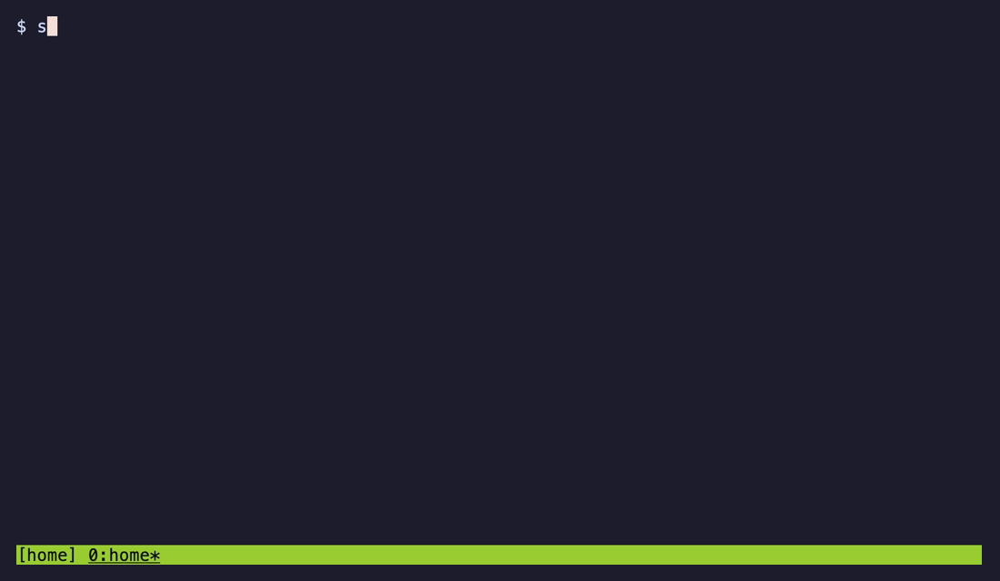

# sessionsnap

[](https://github.com/pawanpaudel93/sessionsnap/actions/workflows/ci.yml)
[](LICENSE)


**Save and resume your coding-agent sessions in cmux and tmux.**



Website: <https://sessionsnap.pawanpaudel.com.np>

sessionsnap takes named, versioned snapshots of [cmux](https://cmux.com) workspaces (or tmux
sessions) and the agent sessions in their tabs (Claude Code, Codex and more). Save what is open, edit it, and later reopen
only what is missing, with each agent tab resumed in its own folder with the flags it was started
with that sessionsnap knows to be safe to pass again. It is a single Rust binary with a CLI, a web UI in the cmux Dock (or the browser from tmux), and cmux palette commands.

Nothing runs in the background unless you add an automatic snapshot: every other snapshot is one
you ask for.

## Contents

- [Features](#features)
- [Requirements](#requirements)
- [Installation](#installation)
- [Usage](#usage)
- [Supported agents](#supported-agents)
- [Web UI](#web-ui)
- [Configuration and files](#configuration-and-files)
- [Security](#security)
- [Status](#status)
- [Uninstalling](#uninstalling)
- [Development](#development)
- [Contributing](#contributing)
- [License](#license)

## Features

- **Snapshots with history:** every `save` to an existing name is a new version; list, diff and
  restore any version.
- **Agent-aware restore:** agent tabs come back resumed (`claude --resume <id>`,
  `codex resume <id>`, …) with their original flags (the ones on the agent's allow-list); plain
  tabs reopen in their folder.
- **Restore only what is missing:** a restore is a plan you can preview (`--plan`) before anything
  opens; workspaces and tabs that are already open are left alone.
- **Edit snapshots:** rename, reorder and remove workspaces, move tabs between them, add agent
  sessions by ID.
- **Move to another machine:** `export` writes a version as one file; `import` saves it there,
  with `--map` moving its folders.
- **Find lost sessions:** `recent` lists agent sessions from the last day that are not open in the terminal.
- **Scriptable:** every command takes `--json` and `--yes`, with stable exit codes.
- **Web UI and palette:** a page in the cmux Dock (or the browser from tmux), and commands in the
  cmux command palette.
- **Automatic snapshots:** `schedule add` saves a snapshot every interval, through launchd on macOS
  or a systemd user timer on Linux.
- **tmux too:** inside tmux, sessionsnap saves and restores tmux sessions, on macOS and Linux.

## Requirements

| Requirement | Details |
| --- | --- |
| OS | macOS (tested on macOS 15), or Linux (x86_64, arm64) with tmux. cmux on Linux is a different app with a different command line, not supported yet |
| Terminal | [cmux](https://cmux.com) 0.64 or newer (tested on 0.64.22 and 0.65.2), or tmux (tested on 3.8) |
| Agents | The agents you want to restore, on your `PATH` (`sessionsnap agents` checks) |
| Build (from source only) | Rust 1.96 or newer |

## Installation

```sh
curl -fsSL https://sessionsnap.pawanpaudel.com.np/install.sh | sh
```

The installer:

1. Picks the build for your system: one universal binary for macOS (Apple Silicon and Intel), a
   static binary for Linux x86_64 or arm64.
2. Downloads the latest release from GitHub, checks its SHA-256, and checks that the new binary
   runs and reports that version before it replaces an installed one. The checksum comes from the
   same release as the archive, so it catches a corrupted download, not a replaced release.
3. Installs `sessionsnap` into `~/.local/bin` and adds that folder to `PATH` in your shell's
   startup file (zsh, bash or fish) if it is not there yet.
4. On macOS, if `cmux` is on your `PATH`, offers to add the sessionsnap commands to the cmux
   palette (`sessionsnap install-cmux`, which asks before changing anything). The palette is
   macOS-only; on Linux the installer skips this step.

Running it again upgrades in place; so does `sessionsnap update`.

| Variable | Default | Effect |
|---|---|---|
| `SESSIONSNAP_VERSION` | latest release | Install this version, e.g. `0.1.0` |
| `SESSIONSNAP_INSTALL_DIR` | `~/.local/bin` | Where the binary goes: an absolute path (a leading `~` is expanded) without quotes, `$`, backquotes, backslashes or control characters |
| `SESSIONSNAP_NO_CMUX` | unset | `1` skips the cmux palette step (macOS) |

For example: `curl -fsSL https://sessionsnap.pawanpaudel.com.np/install.sh | SESSIONSNAP_NO_CMUX=1 sh`.

From source:

```sh
cargo install --git https://github.com/pawanpaudel93/sessionsnap
```

Optional integrations:

```sh
sessionsnap install-cmux     # palette commands in cmux on macOS (asks first, backs up cmux.json)
sessionsnap install-skill    # teaches Claude Code, Pi and other agents to use sessionsnap
sessionsnap install-pi       # lets Pi sessions resume with the flags they were started with
```

Shell completions and the man page:

```sh
sessionsnap completions zsh > "${fpath[1]}/_sessionsnap"   # or bash, fish, elvish, powershell
sessionsnap man > ~/.local/share/man/man1/sessionsnap.1
```

## Usage

```sh
sessionsnap save work                 # snapshot everything open (new version if "work" exists)
sessionsnap save work -w Cascadia     # update only one workspace in the snapshot
sessionsnap show work                 # workspaces and tabs
sessionsnap history work              # versions
sessionsnap diff work@3 work@4
sessionsnap restore work --plan       # what would be reopened
sessionsnap restore                   # after a reboot: the most recently saved snapshot (plan first)
sessionsnap list --cwd .              # snapshots with something in this folder (or below)
sessionsnap restore work              # plan, confirm, reopen what is missing
sessionsnap restore work --tab 'Cascadia#3'   # just that tab, into Cascadia if it is open
sessionsnap recent                    # agent sessions from the last 24h not open in the terminal
sessionsnap sessions --agent codex    # Codex sessions on disk
sessionsnap tab work Cascadia#4 --move "Cascadia Community"
sessionsnap tab work Cascadia --add-session <session-id>
sessionsnap tab work Cascadia --add-session <id> --agent opencode
sessionsnap agents                    # supported agents and whether each is on PATH
sessionsnap rename work job           # rename a snapshot (and its schedule)
sessionsnap export work -o work.json  # a version as one file, for another machine
sessionsnap import work.json --map /Users/me=/home/me   # save it there, its folders moved
```

`export` writes only the snapshot: folders, titles, commands and agent session IDs, never an
agent's history of a session. Resuming an agent tab on the other machine needs that session there
too. An import is checked like any version file when restored, and
`restore --plan` shows the command each terminal tab will run: read it before restoring a file
from someone else.

```sh
sessionsnap update --check            # is there a newer release?
sessionsnap update                    # install it over this binary
```

Every command takes `--json` (for scripts and agents: one compact line when piped, indented at a
terminal) and `--yes` (skip the confirmations of `delete`, `prune`, a lower `schedule … --keep`, `restore`,
`recent --restore`, `install-cmux` and `uninstall`). A tab whose folder is gone (a removed git worktree) is restored as
a plain shell in your home folder, with a warning.

| Exit code | Meaning |
|---|---|
| 0 | ok |
| 1 | error (also an `apply`, `restore` or `uninstall` where some steps failed: the normal result, listing them) |
| 2 | terminal unreachable (cmux not running, or tmux not installed) |
| 3 | nothing to do |
| 4 | refused (`needs-confirmation`: a confirmation is needed; `refused`: it would overwrite something) |
| 5 | unknown cmux state or snapshot format |
| 6 | plan stale |
| 7 | not found |

### Automatic snapshots

An automatic snapshot is saved every interval (by launchd on macOS, a systemd user timer on Linux) from the terminal it was added
in (cmux or tmux), even when sessionsnap isn't running. A run with no changes writes nothing, so its
history holds one version per change. Runs are skipped while that terminal is not running or shows
no workspaces, and a run from another terminal (`schedule run` by hand inside the other one) is
skipped too. cmux, in its default socket mode, only answers programs started inside it, so a
scheduled run (started by launchd) saves from the state cmux writes every few seconds, and says so.
`list` shows automatic snapshots under their own heading, and only their schedule saves to them: copy a version
out with `sessionsnap save <name> --from <auto>@<v>` to keep it. A new automatic snapshot keeps the
newest 50 versions, deleting older ones after each save; `--keep N` changes that, `--keep 0` keeps
every version, and one added before `--keep` existed keeps every version. Lowering `--keep` below
the versions it holds asks first (`--yes` answers).

```sh
sessionsnap schedule add work --interval 30m   # new automatic snapshot; saves once now
sessionsnap schedule add daily --interval 1d   # as many as you like, each with its own interval
sessionsnap schedule list                      # interval, running/stopped, latest version, last run
sessionsnap schedule edit work --interval 2h
sessionsnap schedule edit work --keep 200      # keep more versions (0 keeps all)
sessionsnap schedule stop work                 # pause; `schedule start work` resumes
sessionsnap schedule run work                  # save it now
sessionsnap schedule remove work               # make it a normal snapshot (versions kept)
```

Intervals are a number and a unit (`30m`, `2h`, `1d`; at least `1m`). On macOS each schedule is a
launchd agent in `~/Library/LaunchAgents/sessionsnap.schedule.<name>.plist`; on Linux a systemd user
timer and service, `~/.config/systemd/user/sessionsnap-schedule-<name>.{timer,service}` (on a machine
nobody stays logged in to, run `loginctl enable-linger` once so they keep running). `uninstall` removes
them. A schedule runs with the `PATH`, `TMUX_TMPDIR` and `SESSIONSNAP_*` variables of the shell that
last added, edited or started it: after moving tools off that `PATH`, run `schedule edit` from a
shell with the new one, or remove the schedule and add it again.

### tmux

sessionsnap works out which terminal it runs in: inside tmux it uses tmux (even tmux in a cmux tab),
inside cmux it uses cmux, and from anywhere else (another terminal app) the one that is running:
cmux, else a tmux with sessions. `--terminal tmux` or `--terminal cmux` picks one. Each tmux
session is a workspace and each pane a tab. A window split into panes is saved with its layout:
restoring the whole session splits it again the same way, while tabs added to a session that is
still open each get a window of their own. Resizing panes alone is not a change. A restore types
the agent's resume command into its tab's shell. A name tmux can't hold (`.` or
`:`) is kept in the session option `@sessionsnap_name`, and a name another session has gets a
number (`work-2`). With no tmux server running, `save` writes nothing and exits 3.

tmux doesn't say which agent runs in a pane, so sessionsnap looks under the pane's shell for an
agent's process and reads its arguments exactly (`/proc` on Linux, the kernel on macOS). Its session
is the one the arguments name (`--resume <id>`, `codex resume <id>`, `pi --session <id>`); else,
for Claude Code, Codex and Pi, the one session in that folder changed since the agent started, or the newest when the
others stopped before it began (`/clear` starts a new session). Nothing is guessed: when several
sessions there changed at the same time (one may be another terminal's), or several panes run the
same agent in one folder with no ID in their command, those panes are saved as plain tabs, and
`save` says so; it also warns when a pane's command names a session but a newer one started in its
folder since. Each version records the terminal it came from, and an automatic
snapshot keeps saving from the terminal it was added in. The palette is cmux's; the web UI works
with both (see [Web UI](#web-ui)).

## Supported agents

| Agent | Support | Resumes with | Flags restored |
|---|---|---|---|
| Claude Code | Full (tested) | `claude --resume <id>` | [listed below](#how-flags-are-restored) |
| Codex | Full (tested) | `codex resume <id>` | [listed below](#how-flags-are-restored) |
| Grok | Resume only (untested) | `grok -r <id>` | only launches without flags |
| OpenCode | Resume only (untested) | `opencode --session <id>` | only launches without flags |
| Pi | Full (tested with Pi 1.5.0 in cmux and tmux) | `pi --session <id>` | [listed below](#how-flags-are-restored) (with `install-pi`) |
| omp | Resume only (untested) | `omp --session <id>` | only launches without flags |
| Campfire | Resume only (untested) | `campfire --session <id>` | only launches without flags |
| Amp | Resume only (untested) | `amp threads continue <id>` | only launches without flags |
| Cursor Agent | Resume only (untested) | `cursor-agent --resume <id>` | only launches without flags |
| Gemini CLI | Resume only (untested) | `gemini --resume <id>` | only launches without flags |
| Antigravity | Resume only (untested) | `agy --conversation <id>` | only launches without flags |
| Rovo Dev | Resume only (untested) | `acli rovodev run --restore <id>` | only launches without flags |
| Hermes Agent | Resume only (untested) | `hermes --resume <id>` | only launches without flags |
| GitHub Copilot CLI | Resume only (untested) | `copilot --resume <id>` | only launches without flags |
| CodeBuddy | Resume only (untested) | `codebuddy --resume <id>` | only launches without flags |
| Factory Droid | Resume only (untested) | `droid --resume <id>` | only launches without flags |
| Qoder CLI | Resume only (untested) | `qodercli --resume <id>` | only launches without flags |

- **Full:** sessionsnap reads the agent's session history (titles, `sessions`, `recent`, checks that
  a saved session still exists) and resumes it.
- **Resume only:** sessionsnap saves and resumes the session with the command cmux documents for
  that agent; it cannot read its history. These have not been tried with sessionsnap yet, so their
  flags are not known: a session started with no flags resumes, and one started with any flag is
  left out (an unknown flag may limit the agent, such as a sandbox), with a note to resume it by
  hand.
- cmux records which agent runs in a tab. For agents other than Claude Code it does so only after
  `cmux hooks setup <agent>`.

### How flags are restored

A restored tab runs the agent's resume command with the flags it was started with. Only the flags
on the agent's allow-list are saved and passed again, and `save` names any it left out (never their
values). A flag sessionsnap doesn't know, or a flag that limits the agent but can't be saved exactly
as given, leaves out the whole session: restore then opens a plain shell with the reason rather than
resume the agent with fewer limits.

| Agent | Flags kept | Restricting (also kept, fail closed) |
|---|---|---|
| Claude Code | `--model`, `--fallback-model`, `--effort`, `--betas`; `--allowedTools`/`--allowed-tools`; `--add-dir`, `--mcp-config`, `--append-system-prompt-file`, `--system-prompt-file` (paths only); `--dangerously-skip-permissions`, `--allow-dangerously-skip-permissions`, `--ide`, `--verbose`, `--chrome`, `--no-chrome` | `--permission-mode`, `--agent`, `--setting-sources`, `--max-budget-usd`, `--disallowedTools`/`--disallowed-tools`, `--tools`; `--settings`, `--agents`, `--plugin-dir` (paths only: inline JSON leaves out the session); `--strict-mcp-config`, `--restricted`, `--safe-mode`, `--disable-slash-commands`, `--bare` |
| Codex | `--model`/`-m`, `--cd`/`-C`, `--add-dir`, `--dangerously-bypass-approvals-and-sandbox`, `--search`, `--oss`; `-c`/`--config` for `model`, `model_provider`, `model_reasoning_effort`, `model_reasoning_summary`, `model_verbosity` | `--sandbox`/`-s`, `--ask-for-approval`/`-a`, `--profile`/`-p`, `--enable`, `--disable`, `--approve-for-me`; `-c`/`--config` for `approval_policy`, `sandbox_mode`, `profile`, `sandbox_workspace_write.*`, `features.*`, `shell_environment_policy.inherit`/`.exclude`/`.include_only`/`.ignore_default_excludes` |
| Pi | `--provider`, `--model`, `--models`, `--thinking`, `--use-theme`, `--tui-mode`, `--approve`/`-a`, `--no-skills`, `--no-prompt-templates`, `--no-themes`, `--no-context-files`, `--verbose`; `--session-dir`, `--skill`, `--prompt-template`, `--theme` (paths only) | `--tools`/`-t`, `--exclude-tools`/`-xt`, `--no-tools`, `--no-builtin-tools`, `--no-mcp`, `--no-extensions`, `--no-approve`, `--offline`, `--extension`/`-e`; a flag an extension adds (`--plan`) leaves out the session |
| Every other agent | none: a session started with any flag is left out | every flag |

Kept values are checked too: a name is one word, a path can't be inline JSON, and no value may hold
a known credential format. A record of every session seen (`sessions.json`) keeps each session's
newest launch, so an older copy of a snapshot never resumes it with other flags. The full rules
(value checks, Codex `-c` keys, hidden and teammate flags, the record) are in
[How flags are restored](https://sessionsnap.pawanpaudel.com.np/docs.html#restoring).

**Caveat (Claude Code `--settings` under cmux):** cmux 0.65, the version checked, usually records a
Claude Code launch without your `--settings`, when it can merge your settings file into its own hook
settings (that needs Node). sessionsnap then never sees the flag, and restrictions in that settings
file are not restored. Resume such sessions by hand, or pass the restrictions with other flags
(`--disallowedTools`, `--permission-mode`). When the merge can't run, cmux records your
`--settings` as given, and the rules above apply. Other cmux versions are unverified. Codex launches
are recorded as you typed them.

**Pi:** Pi renames its process, which hides the flags it was started with from cmux, tmux and every
other program. `sessionsnap install-pi` adds a small Pi extension
(`~/.pi/agent/extensions/sessionsnap.ts`) that records them in the session itself (never
`--api-key`); sessionsnap reads that record in both cmux and tmux, and leaves out the extension
cmux's own `pi` wrapper adds. A Pi session started without it has no record: it resumes without
flags, and `save` says so. `uninstall` removes the extension.

Want another agent supported? See [Add an agent](ARCHITECTURE.md#add-an-agent).

## Web UI

`sessionsnap ui` serves a small page on `http://127.0.0.1:47317/` and shows it in the cmux Dock (the
right sidebar). From the palette: "sessionsnap: Open UI" (it runs in its own "sessionsnap UI"
workspace). Run in tmux, it opens the page in your default browser instead, and the page saves from
and restores into tmux. `sessionsnap ui --browser` opens it in your default browser from cmux too,
and the page still saves from and restores into cmux. A page opened by hand (a pasted address) has
no key and shows "Not connected", with **Open in cmux** and **Open in browser** (from tmux:
**Reconnect**): the server opens a new page with its key there, and never hands the key to the
page that asked. On macOS the page gets its key through `osascript`'s input, never a command
line; on Linux `xdg-open` would need it on one, so the page opens without it and the keyed link is
printed in the terminal running `sessionsnap ui`.

- **Snapshots:** save what is open, update a snapshot from what is open, rename (the pencil or a
  double-click on its name) or delete one. The list has Manual and Automatic sections.
- **Export and import:** Export downloads a snapshot's latest version as a file; Import… saves one
  exported on another machine. The page reads and writes the files itself; the server never opens
  a file the page names. (Moving folders with `--map` is in the CLI.)
- **Automatic snapshots:** start one with a name and any interval ("Save automatically"); on its
  page, see whether it runs and how its last run went, run it now, stop or start it, change its
  interval, or make it a normal snapshot.
- **Workspaces:** rename (double-click), reorder, remove, drag tabs to reorder or move them, add an
  agent session or a shell tab, add a workspace from what is open in the terminal or from another
  snapshot. Each tab also has Move up, Move down and "Move to…" buttons. Edits are previewed and saved together as one version.
  Hover an agent tab's icon for the flags it resumes with.
- **History:** compare two versions; restore an older one.
- **Restore:** tick workspaces and tabs, see what would open (with the command each terminal tab
  runs), then restore. Each tab in the Workspaces view also has a **Restore this tab** button.
- **Recent:** agent sessions (Claude Code, Codex, Pi) from the last days that are not open in the
  terminal.

A full restore adds only missing agent tabs to a workspace that is already open (a shell might be
a duplicate). A tab you pick (`--tab`, or a subset ticked in the UI) is added to its open workspace
even when it is a shell, or as a plain shell, with the reason, when its session can't be resumed.

Details:

- It runs while its terminal is open and stops after 30 minutes without use; nothing starts at
  login. Stop it with Ctrl-C, or, when it was started from the cmux palette, close the
  "sessionsnap UI" workspace.
- It answers four connections at once and lets 16 more wait (beyond that, 503). It runs one
  command at a time; a command that would wait over 3 s for another is refused, and the page says
  so. It shows its page at most once a second (otherwise 429).
- Flags: `--port <n>` (default 47317), `--idle-minutes <n>` (default 30), `--no-open` (serve
  without showing the page), `--browser` (show it in the default browser, also from cmux).
- The link carries a key after `#` (`…/#t=<key>`), which browsers never send to a server. The key
  lasts as long as the server: each start makes a new one. It never goes on a command line, where
  other users could read it with `ps`: cmux opens the page without it, and the key is handed over
  through cmux's socket. If that fails, the page opens without a key and `sessionsnap ui` prints
  the keyed link in its terminal. If the page has no key or an old one, open it again from the page
  (**Open in cmux**, **Open in browser**, or **Reconnect** from tmux), open that link, or run
  `sessionsnap ui` again.
- In cmux 0.64 the Dock is a beta feature (Settings → Beta Features → Dock). Without it the page
  opens as a normal browser tab.

## Configuration and files

| What | Where | Override |
|---|---|---|
| Snapshots | `~/.sessionsnap/snapshots/<name>/<NNNN>-<time>.json` | `SESSIONSNAP_HOME` |
| Saved sessions' flags | `~/.sessionsnap/sessions.json` (lock files in `~/.sessionsnap/locks`) | `SESSIONSNAP_HOME` |
| Transcript cache (private; what was read of each Claude Code transcript, so a save reads only what was appended) | `~/.sessionsnap/cache/` | `SESSIONSNAP_HOME` |
| Automatic snapshots' schedules | `~/.sessionsnap/schedules.json` | `SESSIONSNAP_HOME` |
| Schedules' launchd agents (macOS) | `~/Library/LaunchAgents/sessionsnap.schedule.<name>.plist` | none |
| Schedules' systemd units (Linux) | `~/.config/systemd/user/sessionsnap-schedule-<name>.{timer,service}` | `XDG_CONFIG_HOME` |
| Claude Code transcripts (read) | `~/.claude/projects` | `SESSIONSNAP_CLAUDE_DIR` (another `~/.claude`) |
| Codex sessions (read) | `~/.codex/sessions` | `SESSIONSNAP_CODEX_DIR` (another `~/.codex`) |
| cmux binary | `cmux` on `PATH` | `SESSIONSNAP_CMUX_BIN` |
| tmux binary | `tmux` on `PATH` | `SESSIONSNAP_TMUX_BIN` |
| cmux state file (read) | macOS: `~/Library/Application Support/cmux/session-com.cmuxterm.app.json`; Linux: `$XDG_STATE_HOME/cmux/` (default `~/.local/state/cmux/`), same name; a placeholder until Linux is supported | `SESSIONSNAP_CMUX_STATE` |
| cmux socket (web UI) | `$CMUX_SOCKET_PATH` (or its older name `$CMUX_SOCKET`), else the path in `~/Library/Application Support/cmux/last-socket-path` | `SESSIONSNAP_CMUX_SOCKET` |
| Claude Code skill (`install-skill`) | `~/.claude/skills/sessionsnap/SKILL.md` | `SESSIONSNAP_SKILLS_DIR` (instead of `~/.claude/skills`) |
| Shared agent skill (`install-skill`; Pi and other agents that read Agent Skills) | `~/.agents/skills/sessionsnap/SKILL.md` | `SESSIONSNAP_AGENT_SKILLS_DIR` (instead of `~/.agents/skills`) |
| Pi extension (`install-pi`) | `~/.pi/agent/extensions/sessionsnap.ts` | `PI_CODING_AGENT_DIR` (Pi's own, instead of `~/.pi/agent`) |
| Pi sessions (read) | `~/.pi/agent/sessions` | `PI_CODING_AGENT_SESSION_DIR`, else `PI_CODING_AGENT_DIR/sessions` (Pi's own) |
| cmux palette config | `~/.config/cmux/cmux.json` (Linux: `$XDG_CONFIG_HOME/cmux/cmux.json` when set) | `SESSIONSNAP_CMUX_CONFIG` |

sessionsnap also reads cmux's state file and `cmux --json --id-format both tree --all`, and matches open tabs to the state file by surface ID (by tty, with a warning, on a cmux that reports no IDs).

Snapshots are format 2 (`"sessionsnap": 2`). Files from pre-release builds (format 1, with
`"type": "claude"` tabs) are shown as "unreadable" until converted by hand: each
`{"type": "claude", …, "sessionId": "<id>"}` tab becomes
`{"type": "agent", …, "agent": "claude", "sessionId": "<id>"}`, and `"sessionsnap": 1` becomes `2`.
When the latest version can't be read, `save` compares with the newest one that can, says so, and
writes a new version. Saves, edits, prunes and deletes of one snapshot take turns (a lock file in
`~/.sessionsnap/locks`, broken after a minute if its holder crashed): a save or edit holds it from
reading the latest version to writing the next, so saves at the same moment never lose a version or
share a number, and an edit never undoes a version saved while it was being made (it refuses with
exit 6 instead).

## Security

Snapshots are user-editable files whose contents end up as commands in a shell, so:

- Every word of a restore command is shell-quoted, and session IDs are validated first (UUIDs for
  Claude Code and Codex).
- A tab whose flags, ID, folder or command hold a control character (newline, ^C, ESC …) is never
  run, and an agent record with one is not saved. A resume command with a backslash is not typed
  into an already open workspace (`cmux send` would turn `\n` into Enter).
- Environment variables from cmux's state are never stored. Of an agent's flags, only those on its
  allow-list are saved; every other known flag (`--append-system-prompt`, `-c mcp_servers…`, …) is
  left out, and `save` names what it left out. A flag sessionsnap doesn't know (`--api-key`,
  `--header`, …) leaves out the whole agent session. Kept values are checked for their kind (inline
  JSON is not a path) and for known credential formats (see
  [How flags are restored](#how-flags-are-restored)). A password typed inside a permission rule or
  other free text is not detected; recognised are token formats, auth headers and URLs with a
  password. A flag that limits the agent (deny rules,
  sandbox, permission mode, settings) that can't be saved exactly as given leaves out the whole
  agent session rather than resume it with fewer limits; so does any flag of an agent whose flags
  are untested. Restore filters old snapshots through the same rules.
- Snapshot versions written by an earlier sessionsnap (before the allow-list) may still hold the
  flags they saved, on disk, until you remove them: save again, then `sessionsnap prune <name>
  --keep 1`, or `sessionsnap delete <name>`. They are never shown or replayed, but the files keep
  them.
- Snapshot files are readable only by you (folder 0700, files 0600), and so are exported files.
- `import` refuses a file with a control character anywhere in it (an escape sequence in a title
  would reach your screen); the rest goes through the same checks when restored; `restore --plan` shows the
  command each terminal tab runs (escaped), so check a file from someone else before applying it.

## Status

Early: cmux on macOS, and tmux on macOS and Linux; the code is organised so other terminals can be
added (see [ARCHITECTURE.md](ARCHITECTURE.md)). cmux on Linux is a different app (cmux Browser,
backed by cmux-tui) with a different command line and state files, and needs its own terminal
adapter. Automatic snapshots use launchd on macOS and systemd user timers on Linux.

Verified with cmux 0.64.22 on macOS:

- `save` captured 9 workspaces and 29 Claude Code tabs; every session ID matched cmux's own record.
- `restore` reopened closed workspaces and resumed their conversations: Claude Code 2.1.296
  (`claude --resume <id>`) and Codex 0.160.0 (`codex resume <id> -a on-request -s workspace-write`,
  saved flags kept, prompt not stored).
- `install-cmux` added the palette commands to cmux's commented `cmux.json`; ⌘⇧P shows them.
- "sessionsnap: Open UI" showed the UI in the Dock; running it again pointed the open page at the
  new key.

Verified with cmux 0.65.2 and tmux 3.8 on macOS, each agent run against a local stand-in model:
Claude Code 2.1.317, Codex 0.163.0 and Pi 1.5.0 were saved with their sessions and flags, closed, and
restored in both terminals, resuming the same conversation with the same flags (Claude Code
`--permission-mode plan --disallowedTools Bash`, Codex `--sandbox read-only --ask-for-approval
on-request`, Pi `--offline --tools read,grep` through `install-pi`). Flag lists checked against
Claude Code 2.1.317 and Codex 0.166.0.

Not yet checked:

- Dragging a tab between workspaces in cmux's own browser.
- `restore` when it has to start cmux itself (after a reboot). Until then, open cmux first, wait
  for it to reopen your workspaces, then restore.

## Uninstalling

```sh
sessionsnap uninstall               # asks first; --yes skips the prompt
sessionsnap uninstall --keep-data   # keep your snapshots and schedules.json in ~/.sessionsnap
```

This removes the `"sessionsnap: …"` palette commands from cmux's `cmux.json` (after backing it
up next to itself; your other commands and comments stay; if its `"commands"` array holds
comments, the step is skipped and you remove those entries by hand), the skill
(`~/.claude/skills/sessionsnap` and `~/.agents/skills/sessionsnap`, each only if sessionsnap wrote it), the Pi extension
(`~/.pi/agent/extensions/sessionsnap.ts`, only if sessionsnap wrote it), every automatic snapshot's launchd
agent (macOS) or systemd timer (Linux; removed even with `--keep-data`, which keeps the snapshots and `schedules.json`),
`~/.sessionsnap` (or `SESSIONSNAP_HOME`) unless `--keep-data` (left alone if it is a symlink or holds files sessionsnap
did not make), and the `sessionsnap` binary. Anything already gone is
reported, not an error. If a step fails (say the binary's folder is not writable), the others still
run, the report lists what was removed and what failed with its error, and the exit code is 1. It
leaves the `PATH` line the installer added in place (other tools may
use `~/.local/bin`) and lists it.

Installed with `cargo install`? `sessionsnap uninstall` removes everything but the binary; then run
`cargo uninstall sessionsnap`.

## Development

```sh
cargo build                                   # target/debug/sessionsnap
cargo test
scripts/check.sh                              # every CI check: fmt, clippy, tests, node, shellcheck
```

No test runs cmux, an agent or a browser; they use fakes and temp dirs.
[ARCHITECTURE.md](ARCHITECTURE.md) describes the code layout for contributors and coding agents;
[AGENTS.md](AGENTS.md) has the short version for coding agents.

<details>
<summary>Releasing (maintainers)</summary>

```sh
scripts/release.sh 0.3.0 --dry-run   # build dist/ and show what would be published
scripts/release.sh 0.3.0             # bump, check, build, commit, tag, push, GitHub release
scripts/release.sh 0.3.0 --local-ci  # the same, with CI's jobs run here in Docker instead of CI's
scripts/ci-local.sh                  # just CI's jobs, here: check.sh, on Linux too, and the minimum Rust
```

Run it on a Mac, on a clean `main` that matches `origin/main` and has passed CI (or with
`--local-ci`, which runs CI's Linux and minimum-Rust jobs locally in Docker instead), with Docker
running, the `aarch64-apple-darwin` and `x86_64-apple-darwin` Rust targets, and `gh` logged in. It
refuses a version older than the current one, sets the version in `Cargo.toml`, `Cargo.lock`
and the site's nav badge and JSON-LD `version` (examples in the text are left alone), runs
`scripts/check.sh`, builds a universal macOS binary (`lipo`) and static Linux binaries for
x86_64 and arm64 (musl, in the pinned `rust:1.99.0-alpine` Docker image; `RELEASE_RUST_IMAGE` overrides
it), and writes to `dist/` one
`sessionsnap-X.Y.Z-<target>.tar.gz` plus `.sha256` per target (`universal-apple-darwin`,
`x86_64-unknown-linux-musl`, `aarch64-unknown-linux-musl`) and `NOTES.md` (release notes: the version's
`CHANGELOG.md` section, or the Conventional Commit subjects since the last tag when it is empty). Then it asks, commits `chore: release vX.Y.Z`,
tags, turns `CHANGELOG.md`'s `## [Unreleased]` section into the version's, dated (and refuses a
version with no section),
pushes `main` and the tag, and creates the GitHub Release. `-y` skips the question;
`RELEASE_ALLOW_DIRTY=1` lets a dry run work on a dirty tree or another branch.

</details>

## Contributing

Contributions are welcome. Read [CONTRIBUTING.md](CONTRIBUTING.md) for setup and checks, and
[ARCHITECTURE.md](ARCHITECTURE.md) for the layout and recipes for adding an agent or a terminal.

## License

[MIT](LICENSE) © 2026 Pawan Paudel
